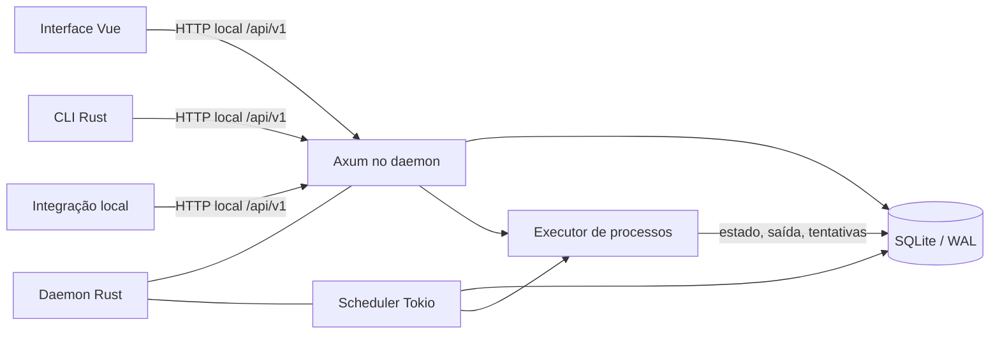
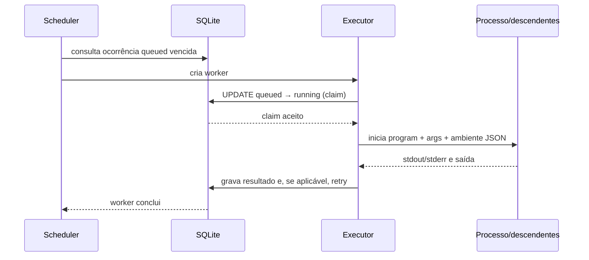

# Funcionamento técnico e mapa do repositório

Esta explicação apresenta o Command Scheduler como sistema e como código. Ela é destinada a quem precisa compreender os limites entre os componentes, seguir uma requisição até o banco ou processo filho e localizar a implementação correspondente no repositório. O contrato HTTP completo continua na [especificação OpenAPI](../../engineering/api/openapi.yaml); procedimentos para compilar e operar estão nos [guias de instalação](../how-to/install-and-operate.md) e de [desenvolvimento Linux](../how-to/start-dev-environment-linux.md).

## Visão de arquitetura

O processo `command-scheduler` combina servidor HTTP, serviço de scheduler e executor de processos. SQLite é o estado persistente. A CLI, a interface web e integrações locais são clientes HTTP da mesma API; elas não acessam o banco diretamente.

Há um único daemon proprietário por arquivo de banco. A API escuta somente em endereço loopback; `Host` deve ser `localhost` ou um IP numérico de loopback. Requisições de navegador precisam ainda usar uma origem HTTP com a mesma autoridade local. Isso protege operações que iniciam processos locais contra páginas remotas e DNS rebinding; não transforma a API em um serviço autenticado para acesso remoto.

## Caminho de leitura do repositório

| Caminho | Responsabilidade no runtime |
|---|---|
| `src/main.rs` | Ponto de entrada do daemon: configuração, lock, bind HTTP, conexão/migrações, recuperação, scheduler e assets estáticos. |
| `src/api.rs` | Rotas Axum, validação HTTP, DTOs, transações das operações de domínio, paginação, serialização e erros Problem Details. |
| `src/storage.rs` | Acesso SQLite, modelos de armazenamento, idempotência, cursor de avaliação, ocorrências de recuperação e retenção. Também registra as migrações embutidas. |
| `src/database.rs` | Reexporta a API SQLite de `sqlx-core`/`sqlx-sqlite`, sem habilitar drivers de outros bancos. |
| `src/scheduler.rs` | Loop de avaliação dos schedules e reivindicação/lançamento das ocorrências prontas. |
| `src/recurrence.rs` | Parsing de cron, cálculo no fuso local, resolução de mudanças de horário e plano de recuperação de horários vencidos. |
| `src/execution.rs` | Claim atômico, início do processo, captura de saídas, cancelamento, finalização e retry automático. |
| `src/process_tree.rs` | Criação e encerramento da árvore de processos: grupo de processos em Unix e Job Object no Windows. |
| `src/bin/cli.rs` | CLI HTTP: converte subcomandos em requisições à API e pagina as listagens que expõe. |
| `migrations/` | Schema SQL versionado. O conteúdo também precisa constar na lista estática de migrações em `storage.rs`, pois o binário empacota esse SQL. |
| `ui/src/main.ts` | Monta a aplicação Vue. |
| `ui/src/App.vue` | Estado e fluxos da SPA: schedules, histórico, agenda, formulário, API Scalar e ações. |
| `ui/src/style.css` | Estilos e layout da interface. |
| `ui/vite.config.ts` | Servidor de desenvolvimento em loopback e proxy para o daemon local. |
| `docs/engineering/api/openapi.yaml` | Contrato HTTP canônico, também servido em `/openapi.yaml` e usado pela referência Scalar. |
| `packaging/` | Units systemd, modelo LaunchAgent e instalador da Tarefa Agendada Windows. |
| `tests/` | Jornadas BDD API/CLI, cenários de navegador e verificação específica da tarefa Windows. |
| `scripts/` | Verificações de publicação, geração de avisos de terceiros, medições operacionais e verificação do supervisor Linux. |

O binário da CLI é um cliente separado, mas não um serviço independente. O binário do daemon serve `ui/dist` ao lado da API; no checkout, encontra os assets ao lado do executável ou recorre a `ui/dist` do projeto. O pacote Cargo contém daemon, CLI, migrações, contrato e licenças, mas não compila nem instala a UI.

## Inicialização do daemon

O fluxo de `src/main.rs` é ordenado para não recuperar dados enquanto outro daemon ativo usa o mesmo banco:

1. Lê `COMMAND_SCHEDULER_ADDR` ou usa `127.0.0.1:4371`; rejeita endereço não loopback.
2. Resolve o caminho SQLite e adquire lock exclusivo no arquivo `<banco>.lock`. O lock é associado ao caminho canônico, para aliases por symlink do mesmo banco não iniciarem outro daemon.
3. Faz bind do listener HTTP. Uma porta ocupada encerra a inicialização antes de tocar na recuperação.
4. Abre o SQLite, habilita foreign keys, WAL, pool de até cinco conexões e busy timeout de cinco segundos; executa as migrações.
5. Inicia a retenção de histórico e marca ocorrências que ficaram `running` como `interrupted`.
6. Inicia a tarefa de scheduler Tokio e monta as rotas HTTP, health, OpenAPI e arquivos da UI.

O lock permanece guardado pela vida do processo. O bind em loopback e a validação de `Host`/`Origin` protegem camadas diferentes: o bind limita conexões de rede; a validação impede que uma página web não confiável use o navegador como cliente local.

## Caminho de uma requisição

`src/api.rs` declara as rotas sob `/api/v1`, recebe estado compartilhado com o pool e o callback de cancelamento, valida entrada e converte linhas SQLite em DTOs. Payloads inválidos são convertidos para respostas Problem Details com `code` estável. O OpenAPI registra schemas e status HTTP para que clientes não precisem inferir detalhes do código.

Na criação de schedule, a API valida executável, argumentos, horário, política, retries, gatilho e limites de JSON. A camada `storage` serializa os valores e os insere em uma transação. Se houver `Idempotency-Key`, armazena também um fingerprint SHA-256 do pedido; repetição da mesma chave e conteúdo retorna o schedule original, e conteúdo diferente entra em conflito. O cursor `last_evaluated_at` começa no instante de criação.

Atualizações de schedule e parâmetros usam transações de escrita para evitar que operações concorrentes percam atualizações. Alteração efetiva de `timing` ajusta o cursor junto com a configuração. O cursor e a ocorrência agendada/de recuperação são persistidos atomicamente; assim uma repetição do polling não duplica o evento já confirmado.

## Avaliação dos horários

`scheduler::run` acorda a cada 250 ms. Em cada ciclo, carrega schedules `active`, compara o próximo instante ao cursor e avalia schedules vencidos; depois consulta ocorrências `queued` cujo `scheduled_for` já chegou.

Para uma ocorrência no limite de até cinco segundos de atraso, grava uma ocorrência agendada normal. Atrasos maiores passam pela política de recuperação e criam ocorrências com origem `recovery`. `recurrence.rs` interpreta expressões cron de cinco campos no fuso local, ignora horas civis inexistentes e escolhe a primeira cópia quando a hora é ambígua. `skip` avança sem ocorrência, `consolidate` agrupa o intervalo, e `sequence` cria até 100 ocorrências individuais e consolida o restante.

O plano de recuperação e o avanço do cursor compartilham uma transação. O `UPDATE` compara o cursor que o scheduler leu e exige que o schedule continue `active`; se outra operação já o alterou, a transação não grava ocorrências duplicadas. Para `sequence`, a consulta de itens prontos só libera a ocorrência mais antiga do schedule e bloqueia a próxima enquanto uma anterior estiver `queued` ou `running`.

## Claim e execução de uma ocorrência

Quando uma ocorrência vence, o scheduler cria uma tarefa Tokio. `execution::execute_queued` primeiro registra um callback de cancelamento e, em uma transação, altera `queued` para `running` condicionalmente. Só o worker que conseguir essa transição carrega o contexto de execução e inicia o processo. Retries em schedules cancelados não podem ser reivindicados.

O processo recebe `program` e `args` diretamente, stdin fechado, stdout/stderr capturados e `COMMAND_SCHEDULER_PARAMS_JSON` com os parâmetros JSON. Ocorrências consolidadas também recebem `COMMAND_SCHEDULER_MISSED_COUNT`, `COMMAND_SCHEDULER_MISSED_FROM` e `COMMAND_SCHEDULER_MISSED_THROUGH`. Não há shell implícito nem interpolação de parâmetros.

`process_tree.rs` agrupa descendentes para encerrar o processo completo: grupo de processos em Unix; no Windows, processo suspenso até ser associado a um Job Object. `execution.rs` limita cada stream a 1 MiB, continua drenando pipes após a saída do processo pai e responde a cancelamento durante execução e drenagem. O endpoint `/commands/test` usa prazo total de 30 segundos; uma execução agendada não tem prazo global de runtime, mas a drenagem de pipes após a saída do pai é limitada.

Ao terminar, o executor persiste estado terminal, timestamps, código de saída, saídas e flags de truncamento. Falhas elegíveis podem inserir a próxima ocorrência de retry na mesma transação da finalização, desde que o schedule ainda não esteja cancelado. Cada retry referencia a ocorrência anterior e conserva número da tentativa e atraso configurado. O cancelamento de um schedule bloqueia retries ainda na fila e futuros, mas não termina processos já iniciados.

## Modelo de persistência

O schema principal define duas entidades:

- `schedules`: configuração serializada em JSON, status, idempotência e cursor de avaliação.
- `occurrences`: origem, estado, tentativa, timestamps, saídas limitadas e metadados de recuperação; `schedule_id` referencia o schedule.

Instantes são armazenados como microssegundos Unix em inteiros. Os DTOs os expõem em RFC 3339. As listagens de schedules e ocorrências usam paginação por cursor opaco baseado na chave de ordenação; o detalhe de ocorrência inclui saídas e a listagem as omite. Um worker de retenção remove ocorrências finalizadas com mais de 90 dias; schedules continuam persistidos.

As migrações existentes são cumulativas e seus checksums não devem ser alterados depois de aplicadas. Ao criar migração, adicione o arquivo à lista `MIGRATOR` em `storage.rs`; essa lista explícita mantém o schema embutido nos binários do pacote.

## Interface e clientes

Em produção, Axum serve os arquivos estáticos da UI na mesma origem da API. A rota `/docs/api` carrega Scalar configurado para ler `/openapi.yaml`. No desenvolvimento, Vite atende somente em `127.0.0.1:5173` e encaminha `/api` e `/health` ao daemon de desenvolvimento (normalmente `127.0.0.1:4372`), preservando a autoridade local esperada pelo middleware.

A SPA em `App.vue` usa `fetch` para `/api/v1`, mantém o estado da lista, detalhe selecionado, agenda, cockpit e histórico, e atualiza dados periodicamente. A CLI converte subcomandos em requisições HTTP, restringe `--server` a HTTP em loopback e percorre páginas para comandos de listagem. Nenhum desses clientes contém uma segunda implementação do scheduler.

## Como navegar ao investigar uma mudança

| Pergunta | Ponto inicial no código |
|---|---|
| Que validação a API faz? | Handler em `src/api.rs`, depois a validação associada e o schema em OpenAPI. |
| Como um dado é persistido? | `storage.rs`, migrations e chamada/transação do handler. |
| Por que um horário venceu ou foi recuperado? | `scheduler.rs` e `recurrence.rs`; em seguida verifique `last_evaluated_at` e as ocorrências. |
| Como o comando recebe parâmetros e como é cancelado? | `execution.rs` e `process_tree.rs`. |
| O que a UI mostra ou envia? | Estado e funções de rede em `ui/src/App.vue`; tipos e rotas correspondentes no OpenAPI. |
| Como confirmar uma jornada de usuário? | `tests/bdd/` ou `tests/web/`; a matriz e o escopo estão em [`tests/bdd/README.md`](../../../tests/bdd/README.md). |
| O que precisa mudar junto com o comportamento? | Página Diátaxis pertinente, `docs/engineering/api/openapi.yaml` para contrato, e `.agents/skills/command-scheduler/SKILL.md` para orientação de agentes. |

Ao seguir uma operação ponta a ponta, comece no handler da API, identifique a transação que grava estado, acompanhe o scheduler que lê esse estado, e termine no executor que persiste o resultado. Essa trilha reflete a principal fronteira do sistema: a API aceita intenção, SQLite a torna durável e o daemon transforma a intenção persistida em processos locais.
